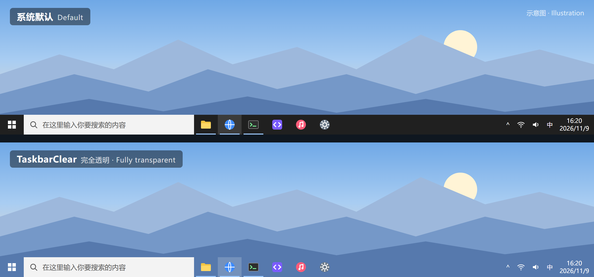

# TaskbarClear

[中文](README.md) | English

A tiny tool that makes the Windows 10 taskbar fully transparent. **No hooks, no injection into Explorer**, and in a side-by-side comparison on my machine, no increase in `NotifyWinEvent` call time was measured (method and steps to re-run: [Measuring it yourself](#measuring-it-yourself)).



<sub>Illustration: the wallpaper and icons are mock-ups, not a real screenshot. Source: [docs/preview/preview.html](docs/preview/preview.html).</sub>

## Why

While chasing occasional stutter in Apex Legends and whole-system freezes when switching Task Manager tabs, I used a probe to time each call to `NotifyWinEvent` (the function Windows uses to broadcast window events):

- On my machine each call took **73–232 µs**; a clean system usually takes single-digit microseconds.
- The cause: every program that subscribes to window events with `SetWinEventHook` adds time to each event **while the global USER lock is held**. Keyboard and mouse input need the same lock.
- Switching one Task Manager tab fires tens of thousands of events. Multiply by hundreds of microseconds each and you get tens of seconds of freeze.

Closing resident programs one by one showed TranslucentTB was one of the biggest subscribers:

Here are the results re-measured in one session with the comparison script in this repository (running / not running, µs per call):

| Program | CREATE event | NAMECHANGE event | Higher in every round? |
|---|---|---|---|
| TranslucentTB 2026.2 (dynamic states on) | 88.4 / 18.4 | 94.2 / 1.2 | Yes, 5 of 5 |
| TranslucentTB 2026.2 (all dynamic states off) | 49.2 / 10.1 | 67.3 / 1.3 | Yes, 5 of 5 |
| **TaskbarClear 1.1.0** | **28.3 / 41.2** | **1.2 / 1.2** | **No, goes both ways** |

(Each cell is the median of 5 rounds, 7 passes per round. NAMECHANGE shows the difference most clearly: TranslucentTB adds 66–93 µs per event, while no difference was measured for TaskbarClear. Test machine, how to re-run, and what this does not cover: [Measuring it yourself](#measuring-it-yourself).)

After closing TranslucentTB and a few other heavy subscribers, switching Task Manager tabs went from a **30–60 s full freeze** to **done in 5–10 s**. I still wanted a transparent taskbar, so I wrote TaskbarClear: it keeps only the "transparent" feature and implements it without any hook.

## Compared with TranslucentTB

| | TaskbarClear | TranslucentTB |
|---|---|---|
| WinEvent hooks | None | Yes |
| Injects into Explorer | No | Yes (`ExplorerHooks.dll`) |
| Extra cost per window event | No increase measured on my machine | Tens of µs per event, measured on my machine |
| Size | One exe, about 40 KB (mostly the icon) | Needs installing |
| Dependencies | .NET Framework 4.x built into Win10 | Ships its own runtime |
| Source | One file, about 350 lines | Full application project |
| Resource use | About 20 MB RAM; CPU measured at about 16 ms per minute on my machine (0.03% of one core) | — |
| Dynamic looks (tint when maximized, Start menu style, etc.) | Not supported | Supported |

**Good fit** if you just want a fully transparent taskbar and care about stable frame times or system responsiveness.
**Not a fit** if you want the taskbar style to change with window state, or you are on Windows 11.

## Install

Download `TaskbarClear.exe` from [Releases](https://github.com/xy-tsuki/TaskbarClear/releases) and put it in a permanent folder.

Or build it yourself. Win10 ships with the compiler; nothing to install:

```bat
C:\Windows\Microsoft.NET\Framework64\v4.0.30319\csc.exe -nologo -optimize -target:winexe -win32icon:assets\icon\TaskbarClear.ico -out:TaskbarClear.exe TaskbarClear.cs
```

Double-click `TaskbarClear.exe` and it runs in the background with an icon in the notification area (it may be hidden under "^"; drag it out if you like). Only one instance is allowed.

Starting with Windows and quitting can both be done from the tray menu; see "Tray menu" below. If you'd rather not use the tray, the command line works too.

Start with Windows (replace the path with yours):

```bat
reg add HKCU\Software\Microsoft\Windows\CurrentVersion\Run /v TaskbarClear /t REG_SZ /d "\"D:\Tools\TaskbarClear.exe\"" /f
```

Remove from startup:

```bat
reg delete HKCU\Software\Microsoft\Windows\CurrentVersion\Run /v TaskbarClear /f
```

Force quit (this does not restore the taskbar style; run `TaskbarClear.exe /restore` afterwards if needed):

```bat
taskkill /f /im TaskbarClear.exe
```

## Tray menu

Right-click the tray icon to open the menu. It is shown in Chinese when the system language is Chinese, and in English otherwise.

| Item | Effect |
|---|---|
| `TaskbarClear 1.1.0` | Title showing the version |
| Re-apply transparency now | Use it when the taskbar turns opaque. Double-clicking the tray icon does the same |
| Start with Windows | Checked when enabled; click to toggle. It edits the `Run` registry value above and is only checked when that value points to this exe |
| Restart TaskbarClear | Restart with the same arguments |
| Exit (restore default taskbar) | Restore the system taskbar look, then quit |

The tray icon uses plain `Shell_NotifyIcon` with no hooks. I re-ran the comparison with the tray icon and still measured no increase in `NotifyWinEvent` time. The icon comes back by itself after Explorer restarts.

## Usage

| Argument | Effect |
|---|---|
| (none) | Run in the background, re-apply transparency every 30 s as a fallback |
| `/interval 60000` | Set the fallback interval to 60 s (minimum 1 s) |
| `/once` | Apply transparency once, then exit |
| `/restore` | Restore the system default look, then exit |
| `/keeponshell` | Don't switch back to the system look while Start or Search is open |
| `/notray` | Don't show the tray icon (quit from the command line instead) |
| `/log D:\path\log.txt` | Log foreground changes and each apply to a file, for troubleshooting |
| `/debug` | With a console build (`-target:exe`), print foreground changes to stderr |

## How it works

- Uses `SetWindowCompositionAttribute` to set a transparent accent (`ACCENT_ENABLE_TRANSPARENTGRADIENT`, color 0) on the primary taskbar `Shell_TrayWnd` and every secondary taskbar `Shell_SecondaryTrayWnd`.
- Explorer resets the style from time to time, and the current style can't be read across processes (`GetWindowCompositionAttribute` fails). So it **reads the foreground window's class every 100 ms** instead. That is a plain read; it subscribes to nothing.
- While Start, Search, Action Center, Task View or the taskbar itself is in front, Explorer is styling the taskbar itself, so TaskbarClear **leaves the taskbar alone** to avoid a tug-of-war that causes flicker.
- When focus returns to a normal window it re-applies at once, then again after 100, 300 and 700 ms, plus a fallback every 30 s.
- When Explorer restarts it broadcasts a `TaskbarCreated` message. TaskbarClear then applies transparency to the new taskbar right away and re-adds its tray icon.

## Measuring it yourself

"Overhead" here means the time each `NotifyWinEvent` call takes. For every window event it broadcasts, the system walks the WinEvent subscribers while holding the global USER lock, so more or heavier subscribers make each call slower. The comparison is simple: time these calls with TaskbarClear running and not running, and see whether there is a consistent gap.

**Test machine**: Windows 10 Home China 22H2 (build 19045.6466), AMD Ryzen 7 5800H, standard user, ExplorerPatcher installed.

**TaskbarClear round by round** (2026-11-09, v1.1.0 with tray icon; each cell is the median of 7 passes, in µs per call):

| Round | Running CREATE | Not running CREATE | Running NAMECHANGE | Not running NAMECHANGE |
|---|---|---|---|---|
| 1 | 25.8 | 41.2 | 1.2 | 1.2 |
| 2 | 28.3 | 23.9 | 1.2 | 1.1 |
| 3 | 28.6 | 95.4 | 1.1 | 1.1 |
| 4 | 17.4 | 43.3 | 1.2 | 1.2 |
| 5 | 43.8 | 18.7 | 1.2 | 1.2 |
| **Median** | **28.3** | **41.2** | **1.2** | **1.2** |

For CREATE neither state is consistently higher; the differences are within the round-to-round noise. NAMECHANGE is practically identical. For contrast, TranslucentTB measured in the same session was clearly higher in every one of 5 rounds (see the table under "Why"). Raw output of all three runs: [`bench/results/2026-11-09.txt`](bench/results/2026-11-09.txt). So the conclusion is: **in this machine's comparison, no increase in `NotifyWinEvent` call time was measured.**

**Re-run it** (only the built-in Windows PowerShell is needed, no admin rights):

1. Put `TaskbarClear.exe` next to the repository's [`bench/`](bench) folder (`bench` in the same folder as the exe).
2. Run the alternating comparison. It takes about 1–2 minutes, starts and stops TaskbarClear by itself, and puts things back the way they were afterwards:

   ```bat
   powershell -ExecutionPolicy Bypass -File bench\compare.ps1 -Rounds 5
   ```

3. Check whether "running" is clearly higher than "not running" in every round. If they go back and forth, no difference was measured.

To test another program, pass its process name with `-Name` and how to launch it with `-Start`. When testing another taskbar tool, the script quits TaskbarClear first and starts it again afterwards. For example, the Microsoft Store version of TranslucentTB:

```bat
powershell -ExecutionPolicy Bypass -File bench\compare.ps1 -Rounds 5 -Name TranslucentTB -Start "shell:AppsFolder\28017CharlesMilette.TranslucentTB_v826wp6bftszj!TranslucentTB"
```

To just see the current cost (for example before and after closing some program, to find heavy subscribers), run the probe alone:

```bat
powershell -ExecutionPolicy Bypass -File bench\winevent_probe.ps1
```

**What this does not cover**
- It only measures WinEvent dispatch cost, not the CPU used by polling itself, and not game frame times.
- It was measured on the one machine above only. The numbers depend heavily on background programs and can vary several-fold on the same machine at different times, so only compare runs alternated in the same session; absolute numbers from different machines are not comparable.
- A new process measures much higher for its first few seconds after creating a window. The probe discards one pass and takes the median of several passes to avoid this. The 73–232 µs figure at the start of "Why" came from the original investigation with an early probe that did not do this, so it may be inflated; the numbers in the table were all re-measured with the current script.

## FAQ

**With ExplorerPatcher installed, the primary taskbar's search box flickers when I open Start on a secondary screen?**
That comes from ExplorerPatcher's secondary-taskbar icon centering, not from TaskbarClear: it still flickers with TaskbarClear closed, and stops once only ExplorerPatcher's secondary centering is turned off. To stop it, turn off secondary centering in ExplorerPatcher's settings, or run this and restart Explorer:

```bat
reg add HKCU\Software\ExplorerPatcher /v MMOldTaskbarAl /t REG_DWORD /d 0 /f
```

**The taskbar sometimes turns opaque again?**
It comes back within 30 s, or as soon as you switch windows. You can also double-click the tray icon, or choose "Re-apply transparency now" from the tray menu. After Explorer restarts it applies to the new taskbar right away.

## Tech stack

C# (single file) + Win32 API via P/Invoke, built with the .NET Framework 4.x `csc.exe` that ships with Windows. No third-party dependencies.

## License

[GPL-3.0](LICENSE)
