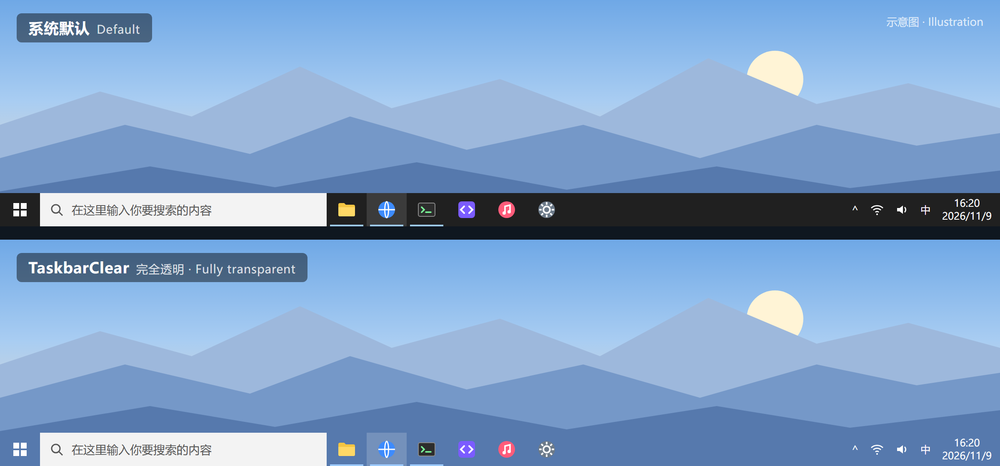

# TaskbarClear

中文 | [English](README.en.md)

一个让 Windows 10 任务栏完全透明的小工具。**不装任何钩子，不注入 Explorer**，在本机对照中，未测到 `NotifyWinEvent` 调用耗时增加（测量方法和复测步骤见[性能对照与复测](#性能对照与复测)）。



<sub>示意图：壁纸和图标是模拟的，不是真实截图。源文件是 [docs/preview/preview.html](docs/preview/preview.html)。</sub>

## 为什么要做

我在排查 Apex Legends 偶发卡顿和任务管理器切换标签时整机卡死的问题时，用探针测了 `NotifyWinEvent`（Windows 广播窗口事件的函数）每次调用的耗时：

- 我的电脑上每次要 **73–232 µs**，干净的系统通常只要个位数微秒。
- 原因是每个用 `SetWinEventHook` 订阅窗口事件的程序，都会让每个事件在**持有全局 USER 锁**期间多花一些时间。键盘、鼠标输入也要拿这把锁。
- 任务管理器切一次标签会发出上万个事件，乘以每次上百微秒，就是几十秒的整机卡顿。

逐个关闭常驻程序后，TranslucentTB 是订阅大户之一：

| 状态 | CREATE 事件 | NAMECHANGE 事件 |
|---|---|---|
| TranslucentTB 未运行 | 20.7 µs | 0.8 µs |
| TranslucentTB 运行（默认开启动态状态） | 69–84 µs | 81–89 µs |
| TranslucentTB 运行（关掉全部动态状态） | 47 µs | 46 µs |
| **TaskbarClear 运行** | **与未运行时无稳定差别** | **与未运行时无稳定差别** |

（普通权限，7 次中位数，用的是早期版本的探针。TaskbarClear 那一行的完整对照数据和复测方法见[性能对照与复测](#性能对照与复测)。）

关掉 TranslucentTB 等几个订阅大户后，任务管理器切换标签从 **30–60 秒整机卡死**变成 **5–10 秒完成**。可我还想要透明任务栏，于是写了 TaskbarClear：只保留「透明」这一个功能，用不需要钩子的方式实现。

## 和 TranslucentTB 比

| | TaskbarClear | TranslucentTB |
|---|---|---|
| WinEvent 钩子 | 无 | 有 |
| 注入 Explorer | 无 | 有（`ExplorerHooks.dll`） |
| 窗口事件额外开销 | 本机对照中未测到增加 | 本机测得每个事件多几十 µs |
| 体积 | 单个 exe，约 40 KB（大部分是图标） | 需要安装 |
| 依赖 | Win10 自带的 .NET Framework 4.x | 自带运行库 |
| 源码 | 一个文件，约 350 行 | 完整的应用工程 |
| 资源占用 | 内存约 20 MB；CPU 本机实测每分钟约 16 ms（单核的 0.03%） | — |
| 动态效果（最大化变色、开始菜单变样式等） | 不支持 | 支持 |

**适合你**，如果：你只想要一个全透明的任务栏，同时在意游戏帧稳定或系统响应。
**不适合你**，如果：你需要按窗口状态切换任务栏样式，或者用的是 Windows 11。

## 安装

从 [Releases](https://github.com/xy-tsuki/TaskbarClear/releases) 下载 `TaskbarClear.exe`，放到一个固定的目录。

也可以自己编译。Win10 自带编译器，不用装任何东西：

```bat
C:\Windows\Microsoft.NET\Framework64\v4.0.30319\csc.exe -nologo -optimize -target:winexe -win32icon:assets\icon\TaskbarClear.ico -out:TaskbarClear.exe TaskbarClear.cs
```

双击 `TaskbarClear.exe` 就开始在后台运行，托盘区会出现它的图标（可能被收在「^」里，可以拖出来）。只允许运行一个实例。

开机自启和退出都可以在托盘菜单里完成，见下面的「托盘菜单」。不想用托盘的话，也可以用命令行。

开机自启（把路径换成你自己的）：

```bat
reg add HKCU\Software\Microsoft\Windows\CurrentVersion\Run /v TaskbarClear /t REG_SZ /d "\"D:\Tools\TaskbarClear.exe\"" /f
```

取消自启：

```bat
reg delete HKCU\Software\Microsoft\Windows\CurrentVersion\Run /v TaskbarClear /f
```

强制退出（不会恢复任务栏样式，之后可以再运行一次 `TaskbarClear.exe /restore`）：

```bat
taskkill /f /im TaskbarClear.exe
```

## 托盘菜单

右键托盘图标会弹出菜单。系统语言是中文时显示中文，否则显示英文。

| 菜单项 | 作用 |
|---|---|
| `TaskbarClear 1.1.0` | 标题，显示版本号 |
| 立即重新设置透明 | 任务栏偶尔变回不透明时点一下。双击托盘图标效果一样 |
| 开机自启 | 打勾表示已开启，点一下切换。改的是上面那个 `Run` 注册表项，只有指向当前这个 exe 时才打勾 |
| 重启 TaskbarClear | 用同样的参数重新启动 |
| 退出（恢复默认任务栏） | 先把任务栏恢复成系统样式，再退出 |

托盘图标用的是普通的 `Shell_NotifyIcon`，不装钩子。加上托盘后重新做了对照，仍未测到 `NotifyWinEvent` 耗时增加。Explorer 重启后图标会自动回来。

## 用法

| 参数 | 作用 |
|---|---|
| （无参数） | 后台常驻，每 30 秒兜底设置一次透明 |
| `/interval 60000` | 把兜底间隔改为 60 秒（最小 1 秒） |
| `/once` | 只设置一次透明，然后退出 |
| `/restore` | 恢复系统默认样式，然后退出 |
| `/keeponshell` | 开始菜单、搜索打开时也不切回系统样式 |
| `/notray` | 不显示托盘图标（只能用命令行退出） |
| `/log D:\path\log.txt` | 把前台窗口变化和每次设置的时间记到文件里，便于排查 |
| `/debug` | 用控制台方式编译（`-target:exe`）时，把前台窗口变化输出到 stderr |

## 工作原理

- 用 `SetWindowCompositionAttribute` 给主屏任务栏 `Shell_TrayWnd` 和所有副屏任务栏 `Shell_SecondaryTrayWnd` 设置透明强调色（`ACCENT_ENABLE_TRANSPARENTGRADIENT`，颜色为 0）。
- Explorer 时不时会把样式改回去，而跨进程又读不到任务栏当前的样式（`GetWindowCompositionAttribute` 会失败），所以改为**每 100 ms 读一次前台窗口的类名**。这只是一次读取，不订阅任何事件。
- 开始菜单、搜索、操作中心、任务视图或任务栏本身在前台时，Explorer 正在自己设置任务栏样式，这时**不去碰任务栏**，避免两边来回抢着设置导致闪烁。
- 焦点回到普通窗口后立刻重新设置透明，并在 100、300、700 ms 后各补一次；另外每 30 秒兜底一次。
- Explorer 重启时会广播 `TaskbarCreated` 消息。程序收到后立刻给新任务栏设置透明，并重新加上托盘图标。

## 性能对照与复测

上面说的「开销」，指的是 `NotifyWinEvent` 每次调用的耗时。系统每广播一个窗口事件，都要在持有全局 USER 锁时逐个检查 WinEvent 订阅者，订阅者越多、越重，这个耗时就越长。对照方法很简单：分别在 TaskbarClear 运行和未运行时测这个耗时，看有没有稳定的差距。

**测量环境**：Windows 10 家庭中文版 22H2（build 19045.6466），AMD Ryzen 7 5800H，普通权限，装有 ExplorerPatcher。

**结果**（2026-11-09，v1.1.0，带托盘图标；每格是 7 遍的中位数，单位 µs/次）：

| 轮次 | 运行中 CREATE | 未运行 CREATE | 运行中 NAMECHANGE | 未运行 NAMECHANGE |
|---|---|---|---|---|
| 1 | 19.9 | 21.2 | 3.2 | 5.2 |
| 2 | 7.3 | 8.8 | 4.3 | 2.5 |
| 3 | 10.7 | 8.1 | 1.8 | 1.7 |
| 4 | 13.0 | 10.0 | 3.9 | 3.6 |
| 5 | 10.2 | 29.8 | 2.9 | 4.1 |
| **中位数** | **10.7** | **10.0** | **3.2** | **3.6** |

两种状态互有高低，差距落在轮与轮之间的波动里。所以结论是：**在本机对照中，未测到 `NotifyWinEvent` 调用耗时增加。**

**自己复测**（只需要系统自带的 Windows PowerShell，不用管理员权限）：

1. 把 `TaskbarClear.exe` 和仓库里的 [`bench/`](bench) 目录放在一起（`bench` 和 exe 同级）。
2. 运行交替对照，大约 1–2 分钟。它会自动启动、结束 TaskbarClear，结束后恢复测试前的状态：

   ```bat
   powershell -ExecutionPolicy Bypass -File bench\compare.ps1 -Rounds 5
   ```

3. 看每一轮「运行中」是否都明显高于同轮的「未运行」。互有高低，就说明测不出差别。

只想看系统现在的耗时（比如关掉某个程序前后各测一次，看它是不是重度订阅者），单独跑探针就行：

```bat
powershell -ExecutionPolicy Bypass -File bench\winevent_probe.ps1
```

**这个测量覆盖不到的地方**
- 只测了 WinEvent 分发的开销，没有测轮询本身占用的 CPU，也没有测游戏帧时间。
- 只在上面这一台机器上测过。数值受后台程序影响很大，同一台机器不同时间也可能差几倍，所以只能看同一时段内的交替对照，不同机器之间的绝对值不能直接比。
- 新进程刚开窗口的头几秒测出来会偏高很多，探针已经先丢掉一遍、再取多遍中位数来避开这个问题。「为什么要做」里那组 TranslucentTB 数据是用早期版本的探针测的，当时没有这样处理，所以绝对值可能偏高；不过同一时段开关前后的对比仍然成立。

## 常见问题

**装了 ExplorerPatcher，副屏打开开始菜单时主屏搜索框会闪？**
这是 ExplorerPatcher 的副屏图标居中引起的，跟 TaskbarClear 无关：退出 TaskbarClear 后照样会闪，只关掉 ExplorerPatcher 的副屏居中就不闪了。想不闪，可以在 ExplorerPatcher 设置里关掉副屏居中，或者运行下面的命令后重启 Explorer：

```bat
reg add HKCU\Software\ExplorerPatcher /v MMOldTaskbarAl /t REG_DWORD /d 0 /f
```

**任务栏偶尔变回不透明？**
最多等 30 秒，或者切换一下窗口就会恢复；也可以双击托盘图标，或在托盘菜单里点「立即重新设置透明」。重启 Explorer 后也会马上对新的任务栏生效。

## 技术栈

C#（单文件）+ Win32 API（P/Invoke 调用），用 Windows 自带的 .NET Framework 4.x `csc.exe` 编译，没有任何第三方依赖。

## 许可证

[GPL-3.0](LICENSE)
